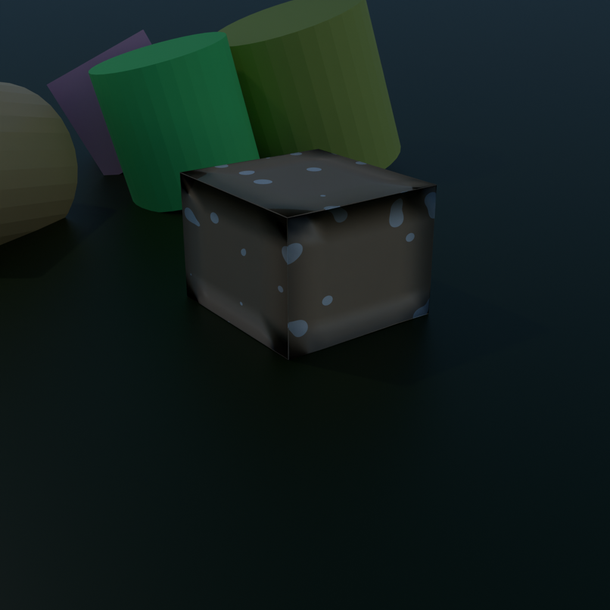
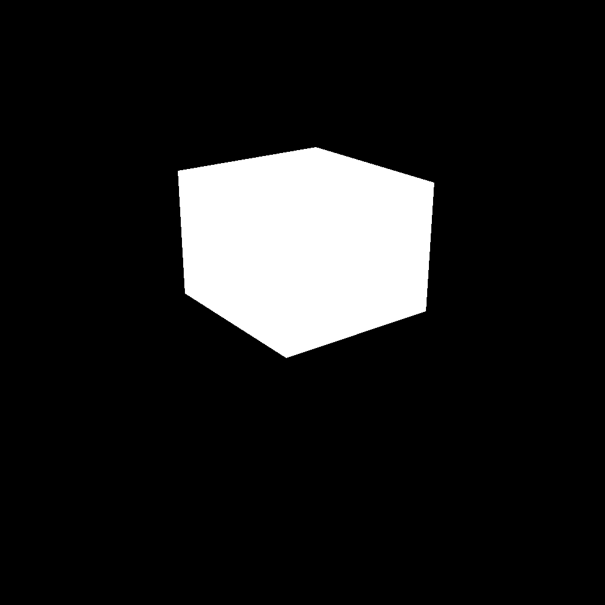
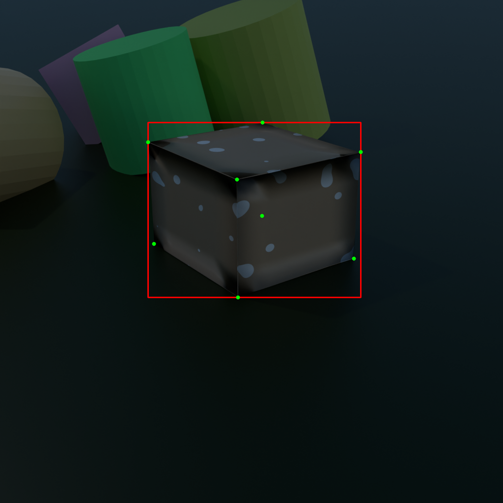
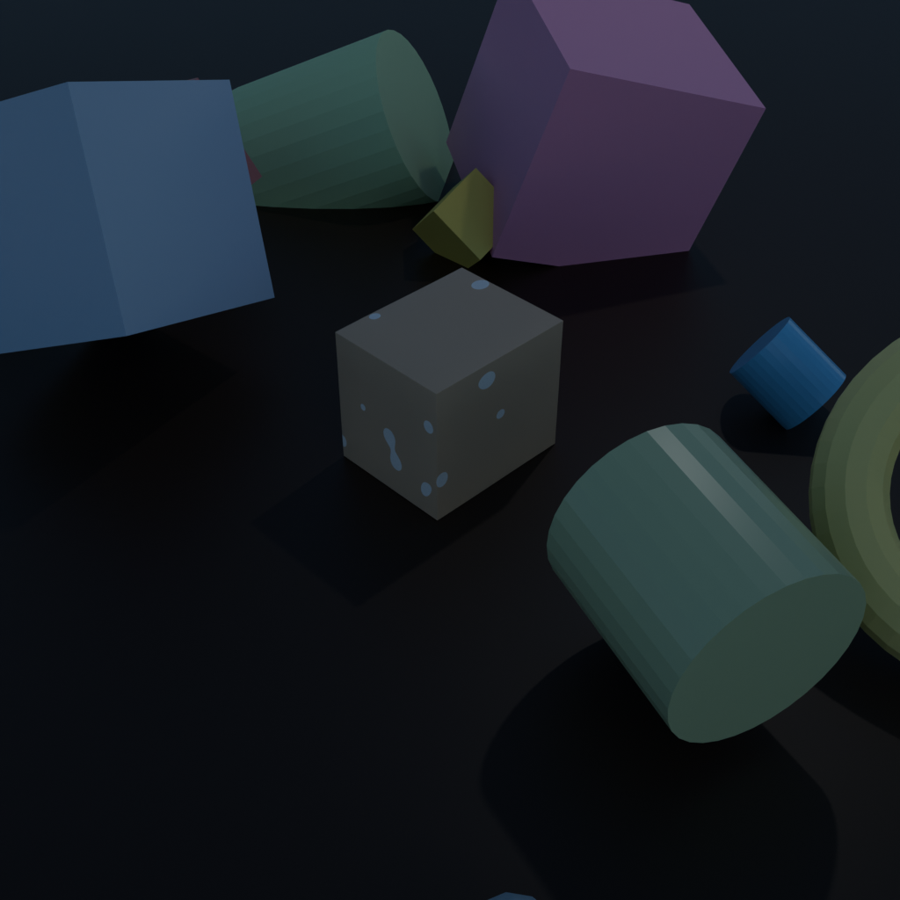
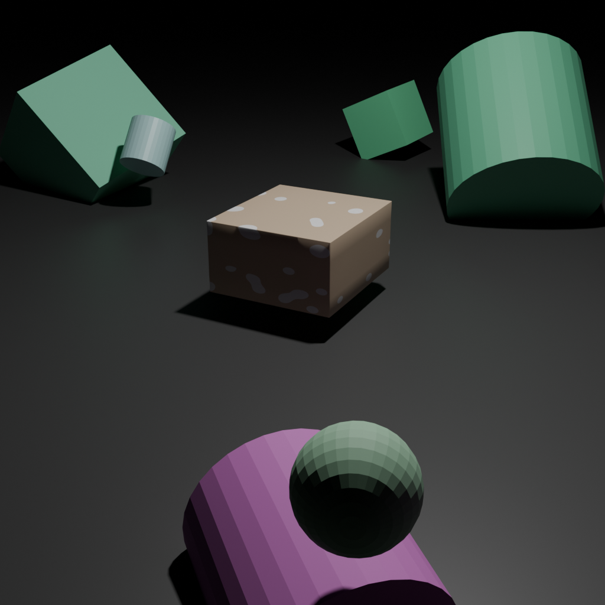

# Industrial SDG Pipeline

[](https://www.blender.org/)
[](https://www.python.org/)
[](https://code.visualstudio.com/docs/devcontainers/containers)
[]()

A procedural Blender-based **Synthetic Data Generation (SDG)** pipeline engineered for machine learning and computer vision tasks in industrial and logistics environments.

The pipeline procedurally creates realistic 3D assets (cardboard packages, wooden pallets, factory structures, and geometric clutter), introduces rich domain randomization (lighting, camera angles, materials, warping, and dents), and renders multi-modal ground truth datasets containing RGB imagery, mathematical amodal segmentation masks, 32-bit floating-point depth maps, and 2D/3D bounding box annotations.

---

## Visual Outputs

Each iteration of the generation pipeline automatically produces aligned modalities and ground truth annotations:

| RGB Synthetic Render | Binary Segmentation Mask | 2D/3D Bounding Box Debug |
| :---: | :---: | :---: |
|  |  |  |
| *Photorealistic Cycles render with procedural textures and clutter* | *Pristine mathematical amodal mask of the target package* | *Projected 3D corners (green) and tight 2D bounding box (red)* |

### Domain & Environment Variations

The generator dynamically alters indoor and outdoor industrial contexts, camera angles, sun positions, and distractor clutter:

| Indoor Setting (Pallet & Concrete) | Outdoor Setting (Dynamic Sky & Sunlight) |
| :---: | :---: |
|  |  |
| *Simulated warehouse setting on wooden pallets with industrial lighting* | *Outdoor environment with atmospheric scattering and terrain variation* |

---

## Core Capabilities

- **Procedural Package Generation (`src/generators/box.py`)**:
  - Realistic cardboard shaders procedurally synthesized in Cycles nodes with randomized warm brown base tones.
  - Procedural shipping labels created using thresholded Voronoi textures.
  - Procedural high-frequency noise simulating printed text and barcodes.
  - Realistic surface imperfections via randomized bevel modifiers and bump mapping.
  - Dynamic deformation and dents using subdivision surface and displacement cloud textures.
  - Variable scale, aspect ratio, and 90-degree rotations.

- **Domain & Environment Randomization (`src/generators/environment.py`)**:
  - **Indoor Warehouses**: Procedural multi-slat wooden pallets, concrete flooring, steel pillars, and ceiling beams illuminated by randomized area lighting.
  - **Outdoor Loading Docks**: Dynamic sky texture model (`MULTIPLE_SCATTERING`) with randomized sun elevation and azimuth, coupled with grass/dirt terrain shaders.
  - **Camera Randomization**: Spherical coordinate positioning (azimuth $0^\circ$–$360^\circ$, elevation $15^\circ$–$50^\circ$, radius $3.5$–$5.5\text{ m}$) targeting the scene origin with automatic tracking quaternion calculation.

- **Visual Distractors & Clutter (`src/generators/clutter.py`)**:
  - Spawns randomized primitive objects (cubes, cylinders, spheres, toruses) distributed in an outer ring around the target object.
  - Random colors, roughness values, and rotations with segmentation pass index `0` to ensure they are excluded from the target package's mask.

- **Multi-Modal Ground Truth Extraction**:
  - **RGB**: High-fidelity Cycles path-traced rendering.
  - **Depth Map (EXR)**: Single-channel 32-bit float (`Z`) depth map extracted through Blender's Compositor node tree.
  - **Amodal Segmentation Mask**: Mathematically computed convex hull projection rendered to an 8-bit binary PNG (`0` or `255`).
  - **2D/3D Bounding Boxes (`src/core/bounding_box.py`)**: World-space 8-corner 3D bounding box evaluated from the scene depsgraph, projected through camera intrinsics/extrinsics to image pixel coordinates, exported as coordinates and overlay images.

---

## Architecture & Codebase

```text
sdg_project/
├── .devcontainer/             # Dev container configuration for VS Code & Docker
│   ├── Dockerfile             # Ubuntu 22.04 + Blender 5.1.1 + PyTorch + OpenCV
│   └── devcontainer.json      # VS Code extensions and interpreter configurations
├── docs/                      # Documentation assets and sample outputs
│   └── images/
├── src/
│   ├── core/                  # Engine, compositing, and annotation extraction
│   │   ├── engine.py          # Cycles render engine setup, samples, and resolution
│   │   ├── compositor.py      # Compositor node tree for depth pass extraction
│   │   ├── bounding_box.py    # 3D bounding box corners and 2D camera projections
│   │   └── exporter.py        # Coordinates exporter and OpenCV debug visualizer
│   ├── generators/            # Procedural asset and environment generators
│   │   ├── box.py             # Procedural cardboard box, labels, and dents
│   │   ├── clutter.py         # Visual distractors and background clutter
│   │   └── environment.py     # Camera, lighting, pallets, and indoor/outdoor worlds
│   └── main.py                # Main pipeline orchestrator and execution loop
├── .gitignore                 # Excludes heavy caches, temporary renders, and EXRs
└── README.md                  # Project overview and documentation
```

---

## Spin Up the Dev Container

Blender 5.1.1 bundles its own internal C++ runtime and embedded Python 3.13 environment. To guarantee reproducible execution without manual system dependency installation, this repository is configured to run inside a **VS Code Dev Container**.

### Prerequisites

1. Install [Docker Desktop](https://www.docker.com/products/docker-desktop/) (or Docker Engine on Linux).
2. Install [Visual Studio Code](https://code.visualstudio.com/).
3. Install the [Dev Containers Extension](https://marketplace.visualstudio.com/items?itemName=ms-vscode-remote.remote-containers) in VS Code.

### Launching with VS Code (Recommended)

1. Clone the repository and open the root folder in VS Code:
   ```bash
   git clone https://github.com/GRawhideMart/senile-dangling-groot.git
   cd senile-dangling-groot
   code .
   ```
2. When the pop-up notification appears in the lower-right corner asking to **"Reopen in Container"**, click it.
   - *Alternatively:* Press `Ctrl+Shift+P` (or `Cmd+Shift+P` on macOS), type `Dev Containers: Reopen in Container`, and press `Enter`.
3. VS Code will build the Docker container (installing Blender 5.1.1, Python 3.13, PyTorch, Albumentations, and `fake-bpy-module-latest` for IntelliSense/Pylance autocomplete).
4. Once connected, open an integrated terminal in VS Code (`Ctrl+\``) — all environment variables and paths are automatically configured.

### Launching with Dev Container CLI

If you prefer the command line:

```bash
# Install Dev Containers CLI if not already present
npm install -g @devcontainers/cli

# Build and start container
devcontainer up --workspace-folder .

# Execute the pipeline directly
devcontainer exec --workspace-folder . blender --background --python src/main.py
```

### Standalone Docker Execution

You can also build and run the Docker container directly without VS Code:

```bash
# Build Docker image
docker build -t industrial-sdg -f .devcontainer/Dockerfile .

# Run the generation pipeline and mount the output
docker run -it --rm -v $(pwd):/workspace industrial-sdg blender --background --python src/main.py
```

---

## Running the Pipeline

Inside the container environment, execute the main entry point via Blender:

```bash
blender --background --python src/main.py
```

> **Tip:** Omit the `--background` flag if you have an X11/VNC display server running and wish to inspect the generated 3D scene and materials interactively inside Blender's viewport.

### Generated Dataset Structure

When execution finishes, the pipeline writes output data to `output/`:

```text
output/
├── images/                    # Rendered RGB frames (PNG, 1024x1024)
│   ├── frame_0000.png
│   └── frame_0001.png
├── masks/                     # Binary amodal segmentation masks (PNG, 1024x1024)
│   ├── frame_0000_mask.png
│   └── frame_0001_mask.png
├── depth/                     # Single-channel 32-bit float depth maps (OpenEXR)
│   ├── frame_0000_depth.exr
│   └── frame_0001_depth.exr
└── debug/                     # Bounding box labels and visual overlays
    ├── frame_0000.txt         # 2D coordinates (x_min, y_min, x_max, y_max)
    └── frame_0000_debug.png   # Verification image with bounding box overlay
```

---

## Development Conventions

All contributions and extensions should adhere to the project conventions:

- **SOLID Principles:** Strictly adhere to SOLID design principles for modularity and separation of concerns.
- **Documentation:** Use **Google-style docstrings** for all classes, methods, and functions.
- **Vertical Alignment:** For code readability, align `=`, `:`, and function parameters vertically:
  ```python
  self.render_path = render_path
  self.resolution  = resolution
  self.samples     = samples
  ```
- **Imports:** Use absolute imports relative to the `src` directory. `src/main.py` prepends its directory to `sys.path`.
- **Stateless Execution:** Generators must clean up orphaned meshes, materials, and textures between iterations to prevent GPU memory leaks across long generation runs.

---

## Roadmap & Planned Features

- [x] Camera randomization (spherical coordinates, distance, elevation).
- [x] 3D bounding box extraction and 2D perspective projection.
- [x] Procedural indoor/outdoor environment randomization.
- [ ] Export formats for popular detection/segmentation frameworks (YOLOv8/YOLOv11, COCO JSON, Pascal VOC).
- [ ] Occlusion metrics and multi-instance generation (stacking pallets and multiple packages).
- [ ] Additional industrial packaging types (cylindrical drums, shrink-wrapped bundles, pallet wrap).
